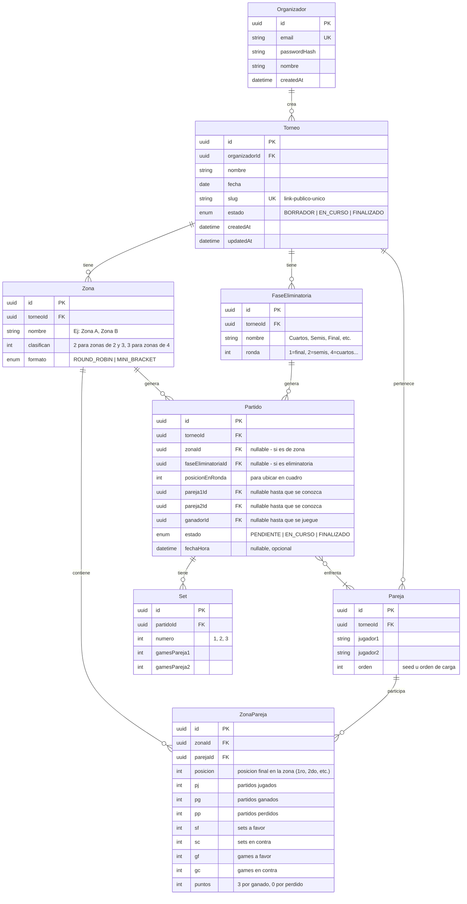

# Plan de Arquitectura — Fixi MVP

> [!NOTE]
> **Estado**: ✅ Aprobado por el usuario. Todas las decisiones confirmadas.

## 1. Modelo de Datos



### Decisiones confirmadas sobre el modelo

#### Formato de zonas
- **Base**: zonas de 3 parejas (round-robin, 3 partidos).
- Si sobra **1 pareja** → una zona de **4** (formato mini-bracket).
- Si sobran **2 parejas** → una zona de **2** (1 solo partido, round-robin trivial).
- La `Zona` tiene un campo `formato`: `ROUND_ROBIN` (zonas de 2 y 3) o `MINI_BRACKET` (zonas de 4).

#### Clasificación por tipo de zona
| Tipo de zona | Parejas | Formato | Clasifican |
|---|---|---|---|
| Zona de 2 | 2 | Round-robin (1 partido) | 2 (ambas) |
| Zona de 3 | 3 | Round-robin (3 partidos) | 2 |
| Zona de 4 | 4 | Mini-bracket (4 partidos) | 3 |

#### Mini-bracket (zona de 4) — detalle
```
Partido 1: Pareja 1 vs Pareja 2
Partido 2: Pareja 3 vs Pareja 4
Partido 3: Ganador P1 vs Ganador P2  → 1ro y 2do de zona
Partido 4: Perdedor P1 vs Perdedor P2 → 3ro y 4to (3ro clasifica, 4to eliminado)
```
Los partidos 3 y 4 se crean con `pareja1Id`/`pareja2Id` en `null` y se completan al cargar resultados de partidos 1 y 2.

#### Sets
- **Best of 3** sets normales.
- Cada set a **6 games**; si empatan 5-5, se va a **7 games**.
- Scores válidos de set: `6-0, 6-1, 6-2, 6-3, 6-4, 7-5, 7-6` (y sus inversas).
- Un partido se gana al llegar a **2 sets**.

#### Desempate en zonas (round-robin)
1. Puntos (3 por victoria, 0 por derrota)
2. Diferencia de sets (SF - SC)
3. Diferencia de games (GF - GC)
4. Resultado del enfrentamiento directo

#### Eliminación directa
- Byes automáticos para completar bracket de potencia de 2.
- Las parejas con mejor ranking de zona reciben bye.
- **El organizador puede editar los brackets** (mover parejas de posición).

#### Autenticación
- Un solo organizador (registro simple, no multi-tenant).

#### Slug
- Auto-generado a partir del nombre + sufijo random (ej: `torneo-verano-2026-x7k`).

---

## 2. Diseño de la API REST

Base URL: `/api`

### 2.1 Auth

| Método | Endpoint | Descripción |
|--------|----------|-------------|
| `POST` | `/auth/register` | Registro del organizador |
| `POST` | `/auth/login` | Login → devuelve JWT |

### 2.2 Torneos (protegido con JWT)

| Método | Endpoint | Descripción |
|--------|----------|-------------|
| `POST` | `/torneos` | Crear torneo |
| `GET` | `/torneos` | Listar torneos del organizador |
| `GET` | `/torneos/:id` | Detalle de un torneo |
| `PATCH` | `/torneos/:id` | Editar torneo (nombre, estado, etc.) |
| `POST` | `/torneos/:id/iniciar` | Genera zonas, sortea parejas, genera partidos de zona |

### 2.3 Parejas (protegido)

| Método | Endpoint | Descripción |
|--------|----------|-------------|
| `POST` | `/torneos/:id/parejas` | Crear pareja |
| `GET` | `/torneos/:id/parejas` | Listar parejas del torneo |
| `PATCH` | `/parejas/:id` | Editar pareja |
| `DELETE` | `/parejas/:id` | Eliminar pareja (solo en BORRADOR) |

### 2.4 Zonas (protegido)

| Método | Endpoint | Descripción |
|--------|----------|-------------|
| `GET` | `/torneos/:id/zonas` | Listar zonas con tabla de posiciones |
| `POST` | `/torneos/:id/generar-eliminatoria` | Genera cuadro de eliminación con los clasificados |

### 2.5 Partidos y Resultados (protegido)

| Método | Endpoint | Descripción |
|--------|----------|-------------|
| `GET` | `/torneos/:id/partidos` | Listar partidos (filtrable por `?zona=` o `?fase=`) |
| `PUT` | `/partidos/:id/resultado` | Cargar/editar sets → recalcula stats y propaga ganador |

### 2.6 Eliminatoria — Edición de bracket (protegido)

| Método | Endpoint | Descripción |
|--------|----------|-------------|
| `PATCH` | `/partidos/:id/bracket` | Mover/editar parejas en un partido del cuadro eliminatorio |

### 2.7 Vista Pública (sin auth)

| Método | Endpoint | Descripción |
|--------|----------|-------------|
| `GET` | `/public/:slug` | Toda la data del torneo en un solo endpoint para polling |

---

## 3. Estructura de Carpetas

### 3.1 Backend (`backend/`)

```
backend/
├── prisma/
│   ├── schema.prisma
│   └── seed.js
├── src/
│   ├── index.js                 # Entry point
│   ├── config/
│   │   └── env.js
│   ├── middleware/
│   │   ├── auth.js              # Verificación JWT
│   │   └── errorHandler.js
│   ├── routes/
│   │   ├── auth.routes.js
│   │   ├── torneo.routes.js
│   │   ├── pareja.routes.js
│   │   ├── partido.routes.js
│   │   └── public.routes.js
│   ├── controllers/
│   │   ├── auth.controller.js
│   │   ├── torneo.controller.js
│   │   ├── pareja.controller.js
│   │   ├── partido.controller.js
│   │   └── public.controller.js
│   ├── services/
│   │   ├── auth.service.js
│   │   ├── torneo.service.js
│   │   ├── zona.service.js      # Distribución + stats + clasificación
│   │   ├── partido.service.js
│   │   └── eliminatoria.service.js
│   └── lib/
│       └── prisma.js
├── .env
├── .env.example
└── package.json
```

### 3.2 Frontend (`frontend/`)

```
frontend/
├── src/
│   ├── main.jsx
│   ├── App.jsx
│   ├── index.css
│   ├── api/
│   │   └── client.js
│   ├── hooks/
│   │   ├── usePolling.js
│   │   └── useAuth.js
│   ├── context/
│   │   └── AuthContext.jsx
│   ├── layouts/
│   │   ├── AdminLayout.jsx
│   │   └── PublicLayout.jsx
│   ├── pages/
│   │   ├── Login.jsx
│   │   ├── Register.jsx
│   │   ├── admin/
│   │   │   ├── TorneosList.jsx
│   │   │   ├── TorneoCreate.jsx
│   │   │   ├── TorneoDetail.jsx
│   │   │   ├── ParejasManager.jsx
│   │   │   └── PartidoResultado.jsx
│   │   └── public/
│   │       └── TorneoPublic.jsx
│   └── components/
│       ├── ZonaTable.jsx
│       ├── MiniBracketView.jsx
│       ├── BracketView.jsx
│       ├── PartidoCard.jsx
│       ├── ProtectedRoute.jsx
│       └── ui/
│           ├── Button.jsx
│           ├── Input.jsx
│           └── Modal.jsx
├── index.html
├── vite.config.js
└── package.json
```

---

## 4. Orden de Implementación (Tickets)

### Fase 0 — Setup Técnico
| # | Ticket | Entregable | Verificación |
|---|--------|-----------|--------------|
| 0.1 | Setup Prisma + Schema | `schema.prisma` completo, migración inicial | `npx prisma migrate dev` sin errores |
| 0.2 | Setup Express base | Entry point con health-check, CORS, error handler, nodemon | `GET /api/health` → 200 |
| 0.3 | Setup Frontend routing | React Router v7, páginas stub, layouts, proxy a backend | Navegar entre rutas sin errores |

### Fase 1 — Auth
| # | Ticket | Entregable | Verificación |
|---|--------|-----------|--------------|
| 1.1 | Backend Auth | Register + Login con bcrypt + JWT | Postman: registro → login → token |
| 1.2 | Frontend Auth | Login/Register + AuthContext + ProtectedRoute | Login → /admin, sin token → /login |

### Fase 2 — CRUD base
| # | Ticket | Entregable | Verificación |
|---|--------|-----------|--------------|
| 2.1 | Backend CRUD Torneos | Crear, listar, editar torneo | Postman: CRUD funciona con JWT |
| 2.2 | Backend CRUD Parejas | Crear, listar, editar, borrar parejas | Postman: ABM con validaciones |
| 2.3 | Frontend Torneos | TorneosList + TorneoCreate + TorneoDetail (shell) | Crear torneo desde UI |
| 2.4 | Frontend Parejas | ParejasManager con formulario inline | ABM parejas desde UI |

### Fase 3 — Lógica de Zonas
| # | Ticket | Entregable | Verificación |
|---|--------|-----------|--------------|
| 3.1 | Backend: Iniciar torneo | Genera zonas (3/2/4), sortea, crea partidos | 10 parejas → 1×4 + 2×3 correctas |
| 3.2 | Backend: Resultado zona (RR) | Guarda sets, recalcula ZonaPareja (round-robin) | 3 resultados → tabla correcta |
| 3.3 | Backend: Resultado zona (mini-bracket) | Propaga ganador/perdedor en zona de 4 | Cargar P1+P2 → P3 y P4 se completan |
| 3.4 | Frontend: Zonas + Tabla | ZonaTable + MiniBracketView + PartidoCard | Ver zonas y scores en UI |
| 3.5 | Frontend: Cargar resultado | Modal para ingresar sets | Cargar resultado → tabla actualizada |

### Fase 4 — Eliminación Directa
| # | Ticket | Entregable | Verificación |
|---|--------|-----------|--------------|
| 4.1 | Backend: Generar cuadro | Crea bracket con clasificados + byes | 6 clasificados → cuartos con 2 byes |
| 4.2 | Backend: Propagar ganadores | Resultado eliminatoria → avanza ganador | Semi1+Semi2 → Final completa |
| 4.3 | Backend: Editar bracket | PATCH mover parejas en cuadro | Organizador intercambia posiciones |
| 4.4 | Frontend: BracketView | Cuadro eliminatorio visual | Bracket renderiza correctamente |
| 4.5 | Frontend: Resultado eliminatoria | Reusar form de resultado | Cargar semi → bracket se actualiza |

### Fase 5 — Vista Pública
| # | Ticket | Entregable | Verificación |
|---|--------|-----------|--------------|
| 5.1 | Backend: Endpoint público | `GET /public/:slug` completo | Sin auth, devuelve toda la data |
| 5.2 | Frontend: Vista pública | TorneoPublic con polling 15s | `/:slug` muestra torneo en vivo |

### Fase 6 — Polish + Deploy
| # | Ticket | Entregable | Verificación |
|---|--------|-----------|--------------|
| 6.1 | Seed de datos | Torneo completo de prueba | `npx prisma db seed` → navegable |
| 6.2 | Deploy | Render + Vercel + Neon | URL pública funcionando |
