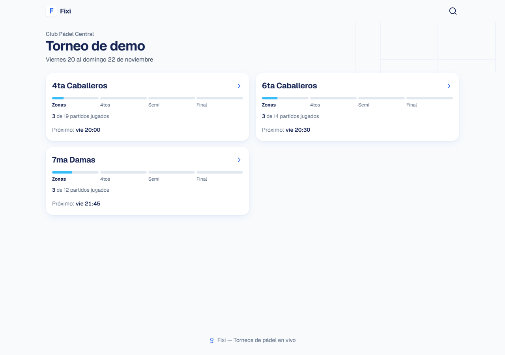
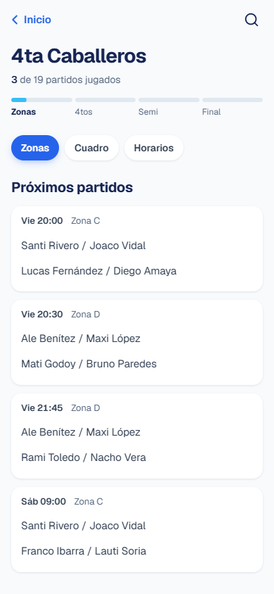
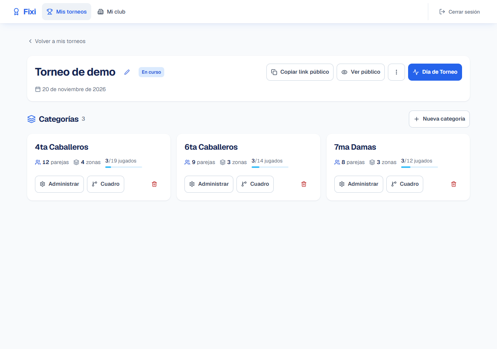
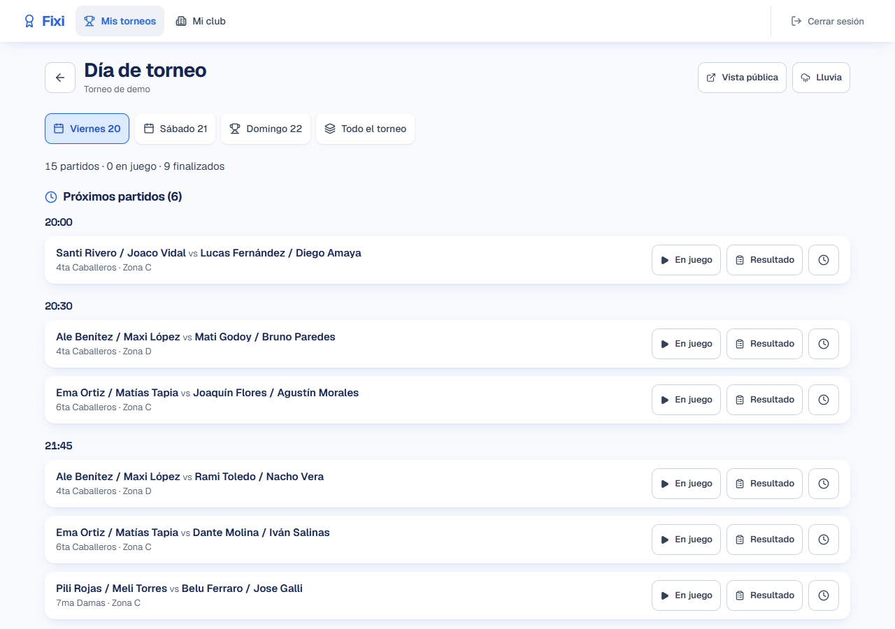

# Fixi

App web para organizar torneos de pádel amateur de fin de semana: inscripción de parejas con su disponibilidad horaria, armado de zonas, programación automática de partidos en las canchas del club, carga de resultados y cuadro eliminatorio, con una vista pública en tiempo real para jugadores y espectadores.

La usé con las inscripciones reales de torneos de un club de San Francisco (Córdoba), donde hasta ahora todo se llevaba en papel y planillas. Los datos de este repositorio son ficticios.

| Vista pública | Vista pública en el celular |
| --- | --- |
|  |  |

| Panel del organizador | Día de torneo |
| --- | --- |
|  |  |

## Qué resuelve

Un torneo típico tiene 80 o más parejas en varias categorías, se juega de viernes a domingo en 3 o 4 canchas, y cada pareja solo puede jugar en ciertos horarios ("el viernes después de las 19", "el sábado no"). Armar zonas y horarios que respeten todo eso le lleva horas al organizador, y cualquier cambio (una lluvia, una pareja que no llega) lo obliga a rehacer la grilla.

Fixi automatiza esa parte:

- **Armado de zonas según disponibilidad:** agrupa a las parejas que tienen horarios en común. Si el armado voraz deja parejas afuera, un paso de reparación busca otro armado que deje menos.
- **Programación de partidos:** asigna día, hora y cancha respetando la disponibilidad de cada pareja, los descansos entre partidos y las reglas del torneo. Los partidos de madrugada cuentan para la jornada anterior, los dieciseisavos se juegan el sábado y desde octavos se juega el domingo.
- **Pre-check antes de iniciar:** simula el inicio en una transacción y muestra qué partidos quedarían sin horario y qué parejas habría que mover para que entren.
- **Modo lluvia:** cuando se reducen las canchas, reprograma lo pendiente sin adelantar ningún partido. Al restaurar, devuelve cada partido a su horario anterior o al hueco libre más cercano.
- **Día de torneo:** muestra qué se está jugando, qué viene y qué falta cargar, con cronómetro por partido.
- **Inscripción pública por link:** las parejas se anotan solas desde el celular. Tiene límite de pedidos por IP y honeypot, y la inscripción se cierra cuando arranca el torneo.
- **Vista pública:** un link por torneo, sin cuenta, con zonas, posiciones, cuadro y horarios por jornada.

## Stack

| Capa | Tecnología |
| --- | --- |
| Frontend | React 19, Vite, React Router 7, CSS propio con tokens de diseño, lucide-react |
| Backend | Node.js, Express 5, Prisma 6 |
| Base de datos | SQLite en desarrollo (el esquema es portable a PostgreSQL) |
| Autenticación | JWT + bcrypt, con control de acceso por organizador en cada recurso |
| Calidad | oxlint, suites de integración propias, fuzz testing del scheduler |

## Tests

- **53 suites de integración en el backend** (`npm test`): cada una levanta el servidor contra una base de test aislada. Un guard impide correr tests contra la base de desarrollo. Cubren el scheduler, el modo lluvia, las eliminatorias, la autorización entre organizadores (IDOR), la inscripción pública, el determinismo de las consultas y la paridad de zona horaria entre frontend y backend en tres husos distintos.
- **Fuzz testing del scheduler** (`npm run test:fuzz`): genera torneos aleatorios con 500 semillas reproducibles, los inicia, les aplica una lluvia y los restaura. Después de cada etapa verifica invariantes: ninguna cancha ni pareja con dos partidos superpuestos, todo dentro del horario del club y alineado a la grilla de 15 minutos, ningún partido de zona el domingo y al menos 75 minutos de descanso entre rondas eliminatorias. Los hashes de los resultados se comparan con un baseline para detectar cambios de comportamiento.
- **Tests del frontend** (`npm test` en `frontend/`) para la lógica de presentación: grilla de horarios, agrupación por jornada y avisos del pre-check.

## Cómo correrlo

Requisitos: Node.js 20 o superior.

```bash
# Backend
cd backend
npm install
cp .env.example .env      # en Windows: copy .env.example .env
npx prisma migrate deploy
npx prisma db seed        # carga el torneo de demo
npm run dev               # http://localhost:3001

# Frontend (en otra terminal)
cd frontend
npm install
npm run dev               # http://localhost:5173
```

El seed crea un torneo de demo con 29 parejas ficticias en 3 categorías, cada una con su disponibilidad horaria. Lo inicia con el mismo flujo que el panel (pre-check, zonas y horarios automáticos) y carga algunos resultados.

- Panel: http://localhost:5173/login, con `demo@padel.com` / `123456`.
- Vista pública: http://localhost:5173/torneo/torneo-demo

En `backend/.env`, `DATABASE_URL` tiene que quedar como `"file:./dev.db"`. Para correr los tests, creá `backend/.env.test` con `DATABASE_URL="file:./test.db"`, `PORT=3002` y un `JWT_SECRET` cualquiera.

### Producción

Con `NODE_ENV=production`, el backend no arranca si `JWT_SECRET` es el valor de ejemplo o tiene menos de 32 caracteres. Para generar uno:

```bash
node -e "console.log(require('crypto').randomBytes(32).toString('hex'))"
```

## Estructura

```
backend/
  src/services/      lógica de dominio: zonas, scheduler, lluvia, eliminatorias
  src/controllers/   endpoints REST
  prisma/            esquema, migraciones y seed de demo
  scripts/           suites de test, fuzz y fixtures
frontend/
  src/pages/admin/   panel del organizador
  src/pages/public/  vista pública e inscripción
  src/components/    componentes compartidos
```

`CONTEXT.md` y `BITACORA.md` registran las decisiones de diseño y el trabajo de cada sesión.
